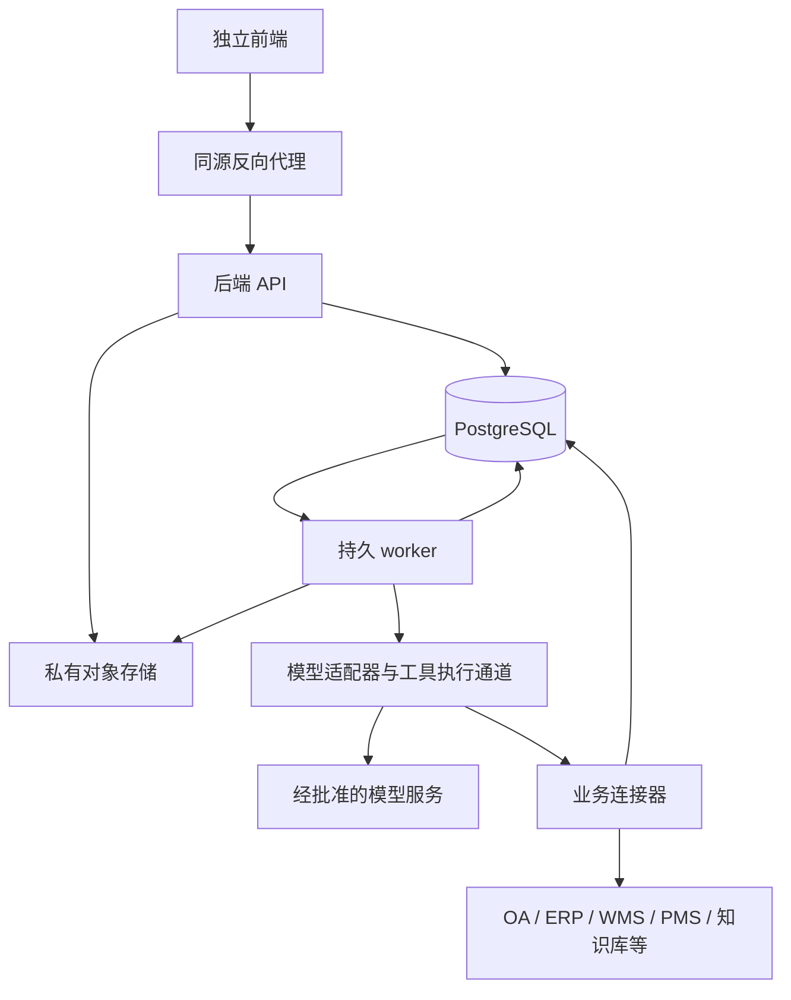

# 系统架构

状态：推荐设计基线，2026-11-14。尚未实现应用、接入生产系统或验证运行容量。本文中的恢复目标和容量均为待实验校准的候选值，不能作为 SLA。

本文承接 [需求文档](REQUIREMENTS.md)，接口以 [API 文档](API.md) 和 `contracts/openapi.json` 为契约；实体见 [数据模型](DATA_MODEL.md)，执行与学习见 [运行机制](RUNTIME.md)。组织政策的待确认项见 [决策记录](DECISIONS.md)。

## 1. 架构目标与边界

OrgLoop 为跨业务事项提供持续的上下文、证据、支持请求、授权执行和经验复用。任何成员都可发起事项；具体受理、资源分配和决定权按经公司确认的政策执行，不由职级标签或模型推荐自动授予。

- 全公司业务进入同一覆盖目录，连接器分批兑现；一个场景通过不能证明全公司能力成立（REQ-012）。
- 前端与后端分别构建、部署，通过 `/v1` API 协作；前端不访问数据库、不持有模型和业务系统凭据（REQ-013）。
- 原系统继续负责其权威业务记录；OrgLoop 管理跨系统关联、必要副本与协作记录，不重建整套 ERP/WMS。
- 模型处理理解、探索和方案调整；代码保障身份、授权、预算、并发、记录和可靠执行。有限运行状态不代表现实中只有有限种业务情境。
- 文档审查、契约检查、运行验证和用户验收分别记录；本仓库的文档完成不代表产品效果已验证。

## 2. 推荐组件

| 组件 | 默认选择 | 责任 |
| --- | --- | --- |
| 独立 Web 前端 | React、TypeScript、Vite | 桌面事项工作区、证据阅读、请求与授权交互、纠错、经验管理 |
| API | Python 3.12、FastAPI、Pydantic | 会话、授权、领域命令、查询、契约、事件分页 |
| 持久 worker | 同一 Python 代码库，独立进程 | 模型调用、同步、工具执行、回执核实、经验评测 |
| 主数据库 | PostgreSQL 18 | 结构化对象、来源关联、事项、授权、任务、事件、经验及版本 |
| 附件 | S3 兼容对象存储 | 经授权保存的文档、附件及验证证据；私有桶、短期受控下载 |
| 检索 | PostgreSQL 全文检索；可选 pgvector | 找候选资料与经验，结果仍需来源和当前权限检查 |
| 身份 | 公司 OIDC＋后端会话 | 身份关联、组织成员资格与会话撤销 |
| 接入层 | 按业务系统实现适配器 | 来源版本、权限、同步、操作能力、幂等和回执能力声明 |

具体依赖版本在实现时锁定并运行兼容性检查。Python 3.12 是推荐生态基线，前端构建环境推荐 Node.js 24；不以“最新版本”代替兼容性证据。PostgreSQL 18 是设计基线，目标托管环境若只支持其他受维护版本，须经 ADR 记录差异并重跑迁移、RLS、队列和恢复检查。

## 3. 模块与进程边界

初版采用模块化单体、独立 API 和 worker 进程，共享受控的数据模型与领域规则。

1. **身份与政策**：成员资格、资源访问、委托、动作授权、预算及审计。
2. **来源与检索**：连接器、实体关联、资料版本、陈述、权限依赖与检索。
3. **事项与协作**：目标、未知、上下文、支持请求、决定、行动与结果。
4. **Agent runtime**：组装当前可见上下文、模型与工具适配、持久 run、暂停与恢复。
5. **经验与 Skill**：候选提炼、维护、评测、发布、撤回与复用反馈。

领域模块之间通过应用服务调用，不允许在任意模块直接修改他人的表。任务表和 outbox 与业务状态在同一数据库事务写入；不跨模型或第三方网络调用持有数据库事务。分析、检索与异步执行不能绕过身份和政策模块。

## 4. 前后端分离与身份

前端构建为静态资源，API 为独立服务；生产默认由同一受控域名的反向代理分别路由静态资源和 `/v1`。这满足独立部署，同时减少跨域会话的复杂性。

- OIDC 回调和会话建立由后端处理。浏览器使用安全、HttpOnly 会话 Cookie；状态变更带有效 CSRF 头，后端校验会话、来源和 CSRF。
- 交互命令的 `organization_id`、实际 `actor` 和委托身份从后端会话及已核实委托推导。写入请求禁止自由指定租户或 `acting_as`。
- 后台run持久绑定发起者、有效执行主体、委托、成员/政策版本、登记范围、有效期及预算/步骤；唤醒后按当前权利复核。事项交接、浏览器会话结束或worker重启不自动把旧run切换为新owner或服务账号身份。范围扩大或身份改变需要明确重新授权或新run。
- 需要组织切换时，后端验证成员资格并建立新的组织上下文；不能只信任前端传入的组织标识。
- UI 隐藏按钮不构成授权；每次读、写、下载、检索、事件查询和执行都要检查。
- 首版使用 REST 快照＋游标 JSON 事件，允许有限退避轮询和手动刷新。SSE/WebSocket 另行评估，不是首版依赖。
- 开发合成身份只允许隔离的本地环境，生产启动检查必须拒绝演示身份绕过。

## 5. 数据和授权边界

PostgreSQL 负责事务和查询，RLS 作为第二道组织隔离；应用账号不得为表 owner、超级用户或拥有 `BYPASSRLS`。迁移账号与运行账号分离，组织上下文在事务内设置，连接归还池前不可遗留上下文。RLS 不代替细粒度业务授权。

资料“可被发现”、原文“可阅读”、支持“可申请”、动作“可执行”分别检查。仅当维护人允许发现线索时，才可向无原文权限的成员显示经批准的引荐入口；隐藏关系的存在本身也可能是受保护信息。

源记录撤销权限后，访问入口立即按当前政策拒绝；索引、摘要和缓存的异步失效不能形成泄露窗口。下载链接使用短有效期和必要的下载检查，已发出的有效链接不能被假定可立即收回。对撤销时的在途模型请求和已分发内容，需要停止后续使用、检查输出与执行，并按所选服务的保留机制处理；不能许诺系统能够让外部服务“忘记”已合法收到的信息。

所有检索内容和外部工具返回均视为资料，不作为新的系统指令。连接器和 Skill 不能通过资料文字扩大权限、注册工具或访问网络。初版 Skill 限于受控指导与已登记工具组合，不直接执行任意模型生成代码。

## 6. 持久执行与外部一致性

API 写入事项事件及 job/outbox 后返回；worker 以带租约的任务领取机制执行。`SKIP LOCKED` 可用于多个消费者领取队列任务，但不用于假装得到完整一致的业务快照。

内部数据库事务、幂等键和版本控制能约束内部变更，不能保证跨所有外部系统的 exactly-once。连接器必须声明：是否支持幂等、是否能查询操作状态、是否有撤销/补偿动作。超时且结果未知的外部动作进入 `outcome_unknown`，先核实回执；没有核实能力时交给授权人处理，禁止盲目重试。

动作授权绑定不可变的 `action_id + proposal_version + payload_digest`，生命周期 `version` 独立用于并发控制。合法状态变化不单独使内容授权失效；更改工具、目标、参数、模式或关键来源条件则建立新提案/动作并重新授权。原写权到期后，回执的只读核实可凭独立现行读权进行，重试写仍需要有效授权。

详细状态、恢复及授权检查见 [运行机制](RUNTIME.md)。

## 7. 部署拓扑与容量假设

首个受控试运行环境可采用一个反向代理、一个 API、一个独立 worker、独立 PostgreSQL 和对象存储。数据库与对象存储优先使用具备可验证备份能力的服务；模型通过后端受控出口访问。密钥只在受控运行环境注入，不进入源码、前端构建、提示词或普通日志。

这里的独立指进程/服务责任边界，不强制每个组件单独购买机器。[成本](COSTS.md)的自管参考环境允许前端静态资源、API、worker和数据库共用一台受控VM，明确承担同故障域与资源竞争；托管数据库和正式生产拓扑分别计价验证。

该拓扑有单实例中断风险，适用于尚未承担业务连续性承诺的验证阶段。生产候选拓扑需要 API 多实例、worker 分组、数据库高可用、独立备份与故障域；是否采用须由业务连续性、数据政策与成本共同决定。

未取得实际并发、资料规模、任务时长和模型调用样本前，不声明最大用户数或吞吐能力。压测至少覆盖：权限过滤检索、热点事项并发更新、连接器积压、模型限流、长时间人等待及撤权传播。容量结果记录具体硬件、依赖版本和数据形态。

## 8. 备份、恢复与运维

| 环境 | 候选 RPO / RTO | 成立前提 |
| --- | --- | --- |
| 合成数据开发环境 | 24 小时 / 1 个工作日 | 每日备份、文档和配置可重建 |
| 受控试运行 | 15 分钟 / 4 小时 | WAL/PITR、对象版本/备份、可用恢复人员和已成功演练 |
| 正式生产 | 待业务确认 | 真实损失容忍、地域与合规要求、预算及演练结果 |

以上为候选目标，当前未部署、未演练，不能标为已达成。恢复必须把数据库、附件、来源权限版本、任务执行记录和密钥引用一起检查。索引可重建，但重建期间不能绕过权限或假装资料完整。

恢复后先隔离外部写动作，核对恢复点后可能已经成功的第三方操作，处理 `outcome_unknown`，再开放执行。租约和 worker 状态需重新建立，旧进程不能带着失效租约继续提交。数据库迁移采用单一执行入口、备份和向前修复方案；不能假定所有破坏性变更都能自动降级。

运维记录须覆盖任务等待和积压、执行未知、连接器健康/同步延迟、权限失效传播、模型/工具成本、失败恢复与经验撤回。日志按权限分层，避免记录原文、凭据和完整敏感提示。

## 9. 替代方案与触发条件

| 方案 | 初版取舍 | 重新评估条件 |
| --- | --- | --- |
| 全量微服务 | 暂不采用 | 多团队独立发布、明确故障隔离或吞吐瓶颈，且有运维能力 |
| Temporal | 保留升级选项 | 长流程版本迁移、跨服务补偿和恢复复杂度超过自建 worker 的可验证范围 |
| 独立图数据库 | 暂不采用 | 经真实查询验证，多跳关系检索成为 PostgreSQL 的瓶颈 |
| 独立向量数据库 | 暂不采用 | 索引容量、过滤和检索延迟有实测依据，且权限语义可保持 |
| Redis/Celery | 非基础依赖 | 缓存或调度负载证明需要；仍需数据库权威状态和回执 |
| 全知单 Agent | 不作为设计假设 | 上下文和授权始终按事项组装，多模型/专业组件可替换 |
| 首版全量微调 | 不采用 | 有授权训练数据、可信结果、独立评测与可接受的撤销/保留机制 |

## 10. 架构验证要求

REQ-013 要由独立前端构建、后端启动和契约测试证明；REQ-014 要由真实身份、跨组织隔离、审计与预算测试证明。REQ-006 要注入进程中断、网络超时、重复命令及未知回执。REQ-002/REQ-007/REQ-011 要验证来源更正、资料撤权、隐藏关系和成员纠错。REQ-008～REQ-010 的改善必须在未参与改进的新事项中检验。

当前这些属于未来实现验收，执行状态以 [验证文档](VERIFICATION.md) 为准。

## 11. 一手依据

- [Vite 官方指南](https://vite.dev/guide/)：开发服务器与独立静态构建。
- [FastAPI Features](https://fastapi.tiangolo.com/features/)：基于 OpenAPI 和类型模型的接口能力。
- [FastAPI Background Tasks](https://fastapi.tiangolo.com/tutorial/background-tasks/)：轻量同进程任务与多进程任务执行的区别。
- [PostgreSQL 18 RLS](https://www.postgresql.org/docs/18/ddl-rowsecurity.html)：默认策略、owner 与 BYPASSRLS 边界。
- [PostgreSQL 18 SELECT](https://www.postgresql.org/docs/18/sql-select.html)：队列领取与 SKIP LOCKED 的一致性限制。
- [PostgreSQL 18 连续归档](https://www.postgresql.org/docs/18/continuous-archiving.html)：PITR/WAL 机制；具体服务仍需演练。
- [Temporal Workflow Execution](https://docs.temporal.io/workflow-execution)：durable workflow 的替代能力。
- [OpenAPI 3.1.1](https://spec.openapis.org/oas/v3.1.1.html)、[pgvector 官方仓库](https://github.com/pgvector/pgvector)。
