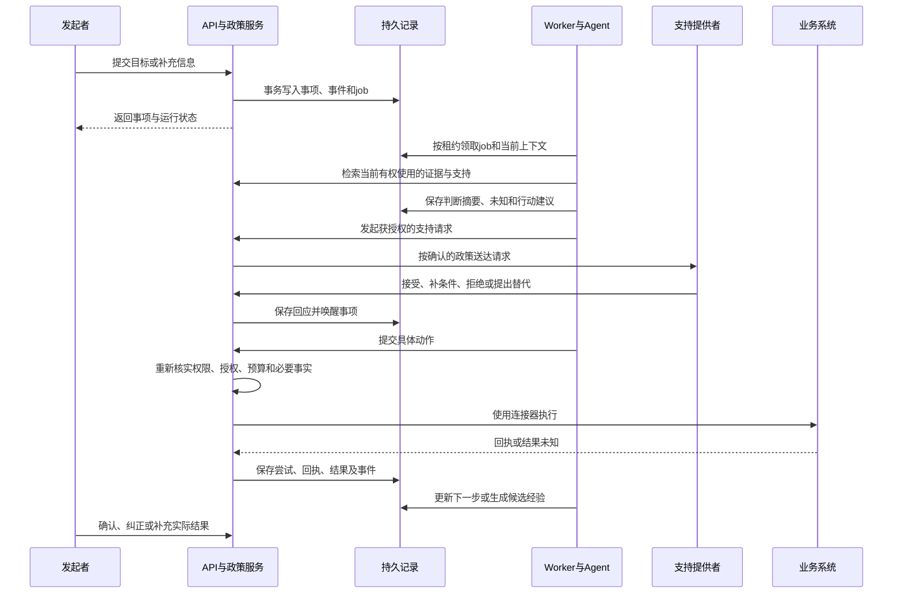
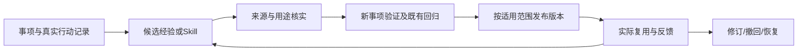

# Agent 运行、协作与学习机制

状态：待实现与验证的设计基线，2026-11-14。本文描述目标行为，不能作为 Agent 已可靠自主运行或模型已经进化的证据。

关联：[需求](REQUIREMENTS.md)、[架构](ARCHITECTURE.md)、[数据模型](DATA_MODEL.md)、[API](API.md)、[决策](DECISIONS.md)、[验证](VERIFICATION.md)。

## 1. 分工

模型负责理解目标、提出假设、查找依据、比较做法、寻找支持和调整下一步；人提供情境、判断、承诺和必要授权。harness 以可执行代码保障身份、工具、预算、持久记录、并发与恢复。

有限状态表示执行到了哪里、正在等什么，不尝试枚举人的所有动机与业务情形。Agent 可以改变方案、寻找反证、建议停止，也可以承认信息不足。Builder/Seller 是可能交替的贡献方式，不固化为员工分类，也不以岗位高低替代证据。

初版每个事项仅允许一个活动 run（`queued/running/waiting/blocked`），其内部可使用多个受控研究或检验步骤。并行分支若未来需要引入，必须另行定义写入范围、预算和集成规则，不能让多个自由 Agent 同时修改同一事项。

run 在创建时持久保存 `initiator_id`、`effective_principal_id`、可空 `delegation_id`、`membership_epoch`、`policy_version`、登记范围、有效期及预算/步骤上限。后台服务仅使用该执行上下文，不能依赖浏览器Cookie仍然存在，或改用worker服务账号的广泛能力。每次唤醒、读取、调用和执行都按当前成员资格、委托、撤权、用途与政策复核，权限不超过登记范围与当前权利的交集。

事项交接不自动迁移旧run身份。新负责人有更多权限、旧成员离职或委托失效时，旧run不能继承新身份继续。若需要不同主体或更大范围，明确重新授权或建立新run，保留旧记录并核实在途动作。允许离线继续的范围和期限由已登记上下文及政策决定，不能靠过期会话或静默刷新权限维持。

## 2. 事项如何被推进

图中送达和外部执行均以已经确认的政策和对应授权为前提。未决定的公司政策不能由 Agent 自动补成“允许”；详见 POL-001、POL-003、POL-008、POL-009。

### 2.1 上下文组装

每次有效步骤先复核持久执行身份，再读取事项当前版本、目标、限制、可用预算、历史行动与未解决部分。只检索该执行主体在登记范围内且当前有权访问的资料，结合实体关联、全文/语义相关性、来源版本与适用条件提供候选上下文；不能改用当前事项owner或通用服务账号的权限补齐资料。

- 来源文字、模型推断、用户偏好、已确认组织规则分别呈现。
- 模型只接收完成当前步骤所需的资料和受控引用，不默认加载公司全部信息。
- 工具返回和资料是待理解内容；其中的指令不具有修改系统政策或请求权限的效力。
- 证据冲突保留差异并寻求核实。目标、关键约束或来源变化后，旧计划和授权需要重新检查。
- 模型建议的结构化结果必须通过 schema 验证，资源标识必须能在当前授权域解析；模型生成的人员、来源或授权 ID 不能直接成为记录。

### 2.2 决定下一步

Agent 可以进行调查、提供建议、请求具体支持或提出操作。判断记录保存依据摘要、关键假设、反证、尚缺信息及复查条件，不要求保存模型完整内部推理。

“有潜力”“重要”“紧急”可以是待解释的评价，不能单独授予资源或高管介入权。任务路由需要结合具体能力、当前可用资源、决定权限及承接意愿。P0 等标签若公司采用，定义与路由分别由政策决定。

没有新证据或有效行动时，Agent 应进入等待、请求补充、建议替代或停止，不能以重复总结维持无限循环。步骤、时间、模型调用和成本都有显式上限。超出预算或打扰额度时，按政策请求新的授权。

### 2.3 支持请求

请求说明需要什么帮助、相关依据、时间条件和期待的下一步。提交、送达、回应、接受、实际履行和结果确认分别记录。支持提供者可以接受、要求补充、拒绝、说明限制或建议替代；适用的受理时限、复核及升级权由 POL-001/POL-002 决定。

支持请求被接受，只形成范围明确的承诺；它不自动授予发送外部消息、读取原文、调整预算或修改生产系统的权限。事项负责人继续存在，Agent 不能以“已推荐某位高管”作为事项完成证据。

已获许可的资源线索可以提供引荐路径；原始资料未获授权时不显示其细节。隐藏关系若未允许被发现，连“后台存在某条关系”也不能透露。

## 3. 运行状态

| 状态 | Run 含义 | 可继续条件 |
| --- | --- | --- |
| `queued` | 已持久记录，等待领取 | 租约、身份与预算有效 |
| `running` | worker 正在进行有限步骤 | 每步核实上下文与执行范围 |
| `waiting` | 等人、工具回执、资料或到期时间 | 对应事件到来，重新核实当前条件 |
| `blocked` | 当前无可用路径，已说明阻碍 | 新信息、替代支持或有效授权改变条件 |
| `completed` | 本次运行已产出可检查结果 | 不等于事项商业目标已成功 |
| `failed` | 本次运行已确认失败 | 修复后可建立新run，原记录保留 |
| `cancelled` | 停止继续运行 | 若重启，明确新范围；在途外部动作仍须核实 |

`waiting_reason` 与阻碍详情分别记录。等待人的 run 不占用持续执行线程，不反复调用模型“看看有没有变化”。使用事件、到期任务或有限频率核实唤醒。

事项状态与 run 分开，使用 `open/active/waiting/blocked/completed/cancelled`。用户更新目标或关键限制后，run 必须读取新版本并重判；旧执行结果不能静默覆盖新的事项版本。

## 4. 工具与外部动作

初版工具通过已登记能力调用，不提供任意数据库 SQL、无限制网络或任意生成代码执行。交互工具入口从后端会话取得身份与组织，后台入口从经当前政策复核的持久执行上下文取得；受控凭据只用于实现其已有权限，模型和worker均无权自行改变业务执行身份。

动作状态为：`proposed → awaiting_authorization → ready → executing`，随后根据核实结果进入 `succeeded/failed/outcome_unknown`，或在尚可取消时 `cancelled`。该路径为执行语义，不强制每个已获预先授权的动作重复人工审批。

Action 的 `version` 是生命周期并发版本，用于 ETag/If-Match；`proposal_version` 和 `payload_digest` 绑定不可变提案。授权使用 `action_id + proposal_version + payload_digest`，不能绑定或混用生命周期 `action_version`。ready、executing、outcome_unknown 等合法状态推进会增加生命周期version，但不单独改变提案或使内容授权失效。

执行前检查：

- 当前主体、组织、委托和资源范围；
- 动作目标、负载摘要、有效期、预算与来源条件是否仍与授权相符；
- 连接器是否支持幂等、状态查询、撤销或补偿；
- 当前 action 生命周期版本、不可变提案绑定、worker 租约及外部动作是否已存在回执。

更改工具、目标、参数、模式或关键来源条件时，建立新不可变提案版本或新action，重新取得相应授权和幂等语义。不能在在途或未知动作上改写已发内容，也不能为恢复而忽略版本。收到回执后验证其目标、远端操作标识及结果，再更新 action 和事项；不能把模型叙述当成回执。

### 4.1 超时、取消和恢复

| 情形 | 处理 |
| --- | --- |
| 网络超时但远端支持幂等与查询 | 先查询原操作；确需重试时使用同一受支持的业务幂等标识 |
| 无法判断远端是否执行 | `outcome_unknown`，保留证据，通过 reconcile 核实；不盲重试 |
| 核实后仍无法确定 | 保存未决结论，保持未知并交由有权者决定下一步，不能伪造失败或成功 |
| 用户取消但调用已经发送 | 停止新的调用，核实在途结果；撤销/补偿是另一个需授权动作 |
| worker 中断或租约失效 | 新worker读取持久记录；旧worker提交须被版本/租约检查拒绝 |
| 来源权限或授权被撤回 | 停止后续读取/执行；检查在途动作与输出，记录影响范围 |

原写授权过期时，对既有动作的只读回执核实可依据核实者独立的现行读权继续，记录核实主体和证据；不要求为了看回执先重授一次写权。该读权不能用来续期旧run或执行重试、撤销/补偿等写操作。若无适当读权，保留未知并请求有权者核实；任何重试写都需要重新有效的授权。

幂等只在连接器和远端实际支持的范围内成立。内部租约与 fencing token 不能把所有外部动作变成 exactly-once。副作用已发生后的补偿也不等于历史从未发生。

### 4.2 前端可见性

前端获取 REST 快照和 `GET /v1/work-items/{id}/events?after=...` 游标事件。游标由服务端解释，不能跨事项拼接读取。状态变化、请求回应和回执以服务端确认数据呈现。

前端可使用手动刷新和有限退避轮询，显示等待原因、最近确认时间、未知结果及需要的人类决定。HTTP 202、生成建议、发出请求都不能在 UI 上直接呈现为“业务完成”。版本冲突按 [API](API.md) 的 428/412/409 处理，并让用户查看新版本后决定。

## 5. 从执行到经验

经验闭环以可核查结果为入口。一次对话结束、用户点赞、高管认可、任务关闭或多Agent一致，都不是结果已经有效的充分证据。

### 5.1 候选内容

记录当时可用信息、行动与结果、判断条件、未决解释、反例、贡献者和需请教的人。Agent 可以辅助提炼草稿，个人经验的共享用途与内容需按 POL-005 确认。业务记录按既有数据权限处理，自动摘要不自动扩大共享范围。

不能从一次成功推出普遍方法，也不能把失败直接归因为某个人。结果存在外部因素或延迟时保留未知。组织应给维护、辅导和验证配置时间与认可，不以提炼数量或“替代人数”证明价值。

### 5.2 验证与发布

经验/Skill 版本共用 `candidate/evaluating/released/superseded/withdrawn` 状态。发布至少记录来源和用途范围、输入输出与适用条件、维护人、验证版本与限制。

验证应包含：

1. 未参与提炼或优化的新事项，检查迁移而非背答案；
2. 必须继续支持的原有事项，检查退化；
3. 输入不足、权限撤销、过时资料、结果未知等边界；
4. 保持事实/目标/约束一致，只改变支持态度或发起者职级的对照；
5. 质量、总人工投入、协调/返工、模型和工具成本；
6. 对无法自动核验的结果，由适当的受益者、专家和责任人提供有依据的评议，保留分歧。

改进阈值和发布权由 POL-007 确认。不能用模型自评分数代替真实成效。发布可以依据已批准的低风险自动规则或相应维护人确认，不强制所有事项层层审批；改变组织权限、预算和评价政策仍需要相应决定权。

### 5.3 持续纠正

发布后保留使用记录、当前来源依赖和反例入口。来源更正、权限撤回、Skill 退化或新风险触发重新验证、降级或撤回；停止新的检索和执行使用，并向受影响的事项提示必要复查。历史版本与回执保留在适当权限内，以解释当时行为。

资源匹配需关注是否持续过度打扰少数专家、是否把既有调用量误当成能力证据、是否让新人永远无法验证能力。可用时间、本人意愿和已承担承诺是匹配的一部分；处理方法须符合 POL-005/POL-009，不能暗中生成员工排名。

## 6. 学习层次与边界

| 改变 | 保存/执行位置 | 需要的证据 |
| --- | --- | --- |
| 当前事项理解 | 事项上下文、run记录 | 新信息如何修正认识 |
| 长期经验 | 经验与来源库 | 条件、用途、结果、可修订性 |
| Skill/工具策略/harness | 有版本的配置与受控代码 | 未见事项、回归、成本及权限检查 |
| 模型权重 | 独立训练与部署项目 | 授权训练数据、可信反馈、模型评测、保留与回退决策 |

首版实现前三类。不能把写入记忆、增加提示词或模型自我总结称作权重已训练。不能把当前用户喜欢的回答直接作为“正确”标签。经验库和运行记录独立于模型保存，更换模型后要重新验证适用能力。

## 7. 最小可证伪验收

**推进验收（REQ-001～REQ-007、REQ-014）：** 合成事项包含资料缺口、支持提供者暂不可用和一次工具超时；系统保留上下文、获取实际承接、核实远端结果，重启后可恢复且无盲目重复操作。最后明确已经做到什么、尚缺什么和结果依据。

**学习验收（REQ-008～REQ-011）：** 候选方法在独立新事项中与基线比较，报告质量、总负担、失败和成本；未证实改善时保留候选或撤回。改变发起者职级和态度不应无依据改变判断；资料撤权或Skill撤回后，新调用不再使用失效内容。

**范围验收（REQ-012/REQ-013）：** 使用研发交付、现场服务和跨层级支持等不同合成情境检查共同机制；保留所有业务的接入状态。前端与后端契约分离可运行后，再检验实际渲染与交互。

**内容授权与状态变更验收（REQ-005/REQ-006/REQ-014）：** 合成action的提案1/摘要D获得有效授权，生命周期version在ready、executing、outcome_unknown间合法递增；原内容授权在未过期、未撤回且条件不变时仍匹配，ETag并发检查继续有效。改变目标、工具、参数、模式或关键来源条件后，旧授权不能匹配新提案。写授权到期后，具有独立现行读权的主体可核实旧回执，但不能自动重试写操作。

**等待、交接与撤权验收（REQ-004/REQ-005/REQ-006/REQ-014）：** 主体A发起run并等待支持，随后事项交给权限更大的B，A的成员资格或委托被撤回，worker在浏览器会话结束后重启。旧run仍绑定A，不能借B或服务账号读取新资料、请求支持或写入；有权核实者只能以独立的当前读权处理已有未知回执。B要继续推进必须通过明确的新run/重新授权，测试保留原身份、撤权、核实及新授权记录。

当前未执行上述运行与效果验收。状态、证据和限制统一进入 [验证文档](VERIFICATION.md)，不能因设计文档或模型评审通过而改为“产品已验证”。
